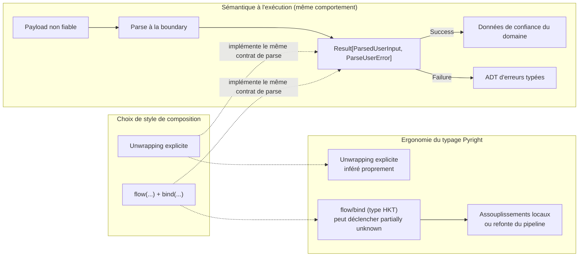

# Module 01 — Never Trust Input
## Plan de leçon détaillé · ~8 minutes en live · Defensive Programming from the Trenches

---

## Vue d'ensemble

| | |
|---|---|
| **Durée** | 8 minutes (live) + 5 min d'exercice en asynchrone |
| **Principe central** | Parse at the boundary. Exposer les échecs explicitement. |
| **Focus Python** | `pydantic` v2, `returns.Result`, `dataclasses`, type hints, `__post_init__` |
| **Ce que retient l'audience** | Je sais où parser l'entrée et comment exposer honnêtement les échecs attendus |

---

## Comment naviguer dans ce dossier

Le dossier se découpe par **activité** :

- `LiveCoding/module_01_never_trust_input/1_live/` : ce que vous tapez en direct
- `LiveCoding/module_01_never_trust_input/2_pour_aller_plus_loin/` : variantes hors live, pour les participants
- `exercises/module_01_never_trust_input/` : l'exercice des participants après la démo
- `presentation.md` : les slides (format Marp), en français
- `README.md` : le point d'entrée avec le déroulé minute par minute et les échecs volontaires

### Correspondance : étapes live et dossiers

| Dossier / document | Étape live | Contenu |
|---|---|---|
| `1_live/0_probleme_confiance_aveugle.py` | Étape 1 | ❌ Le code fait confiance à l'appelant |
| `1_live/ecriture_1_pydantic_exception.py` | Étape 2 | ✅ Pythonic : Pydantic lève `ValidationError` (chemin d'erreur implicite) |
| `1_live/ecriture_2_parse_user_result.py` + `test_ecriture_2_parse_user_result.py` | Étapes 3 et 4 | ✅ FP : `parse_user -> Result[UserInput, str]`, puis les tests |
| `../../exercises/module_01_never_trust_input/3.exercise_product_input/` | Exercice | Même contrat appliqué à un payload plus riche |
| `2_pour_aller_plus_loin/1_exceptions_contre_exemple/` | Hors live | Cascade d'exceptions dans un flux d'inscription |
| `2_pour_aller_plus_loin/2_dataclass_sans_pydantic/` | Hors live | Alternative stdlib (`dataclass` + `__post_init__`) |
| `2_pour_aller_plus_loin/3_erreurs_typees/` | Hors live | `Result[T, ErrorADT]` avec des erreurs typées |
| `2_pour_aller_plus_loin/4_composition_flow_bind/` | Hors live | Un parser par champ, composés avec `flow` et `bind` |
| `2_pour_aller_plus_loin/5_chaines_registration/` | Hors live | Chaînes d'inscription avec exceptions et avec `Result`, côte à côte |

Les noms de fonctions suivent le guide : `UserInput`, `parse_user`, `create_user`.

---

## Objectifs d'apprentissage

À la fin du module, les participants savent :

1. Identifier la **trust boundary** dans n'importe quel système
2. Appliquer **pydantic v2** pour parser et coercer l'entrée brute à la boundary
3. Retourner les échecs attendus en **`Result[Value, Error]`** au lieu de laisser fuir des exceptions
4. Distinguer les stratégies **whitelist** et **blacklist**, et savoir laquelle choisir
5. Nommer au moins 3 catégories de « falsehoods » qui piègent les développeurs

---

## Timing de l'instructeur

```
00:00 — 01:30   Accroche : war story ou question (90 s)
01:30 — 03:00   Concept : qu'est-ce que la boundary ? (90 s)
03:00 — 07:00   Live code : étapes 1 à 4 (4 min)
07:00 — 07:30   Whitelist vs blacklist (30 s)
07:30 — 08:00   Falsehoods + consigne d'exercice (30 s)
```

---

## Accroche (90 s)

**Ouvrez avec cette question à la salle :**

> « Qui ici a passé plus de 30 minutes à déboguer un bug venu d'une entrée inattendue — un `None`, une chaîne vide, un nombre négatif — arrivé trois couches plus haut et qui a corrompu quelque chose en silence ? »

*(Pause. Laissez les mains se lever. Voilà votre audience.)*

**Puis racontez votre war story.** Votre propre incident vaut dix fois une histoire hypothétique.

### ⚔ Emplacement de la war story

> *À remplir avant la session. Angle suggéré : un `None` ou une valeur malformée entrée dans le système sans validation, passée à travers 2 ou 3 couches de logique, puis :*
> - *a corrompu un enregistrement en base en silence*
> - *a causé un calcul faux qui n'est apparu qu'en production*
> - *a déclenché un crash loin de la source réelle*
>
> *Structure : ce qui est entré → où on aurait dû l'attraper → où ça a réellement cassé → combien de temps pour remonter à la cause.*

**Phrase à placer après l'histoire :**

> « Le bug en lui-même importait peu. Nous avions fait confiance à l'appelant. En production, aucun appelant ne mérite cette confiance : ni un utilisateur, ni un frontend, ni un autre service que vous avez écrit vous-même. »

---

## Concept — La trust boundary (90 s)

**Dessinez ceci au tableau ou dites-le à voix haute :**

```
[ Monde extérieur ]  ──►  [ BOUNDARY ]  ──►  [ Votre domaine ]
  users, APIs,            ← parser ici        objets propres, typés,
  queues, fichiers,         une seule fois      de confiance
  env vars, CLI
```

**Points à faire passer :**

- La boundary se trouve partout où des données **entrent** dans le système : endpoints HTTP, arguments CLI, consumers de message queue, lecteurs de fichiers, variables d'environnement, lectures de bases externes
- « Valider plus tard » est fragile ; **parser maintenant** en objets typés de confiance
- Après la boundary, le code peut faire entièrement confiance à ses entrées : c'est le **contrat** que la boundary garantit

**Ce qui compte comme boundary :**

```python
# Toutes ces lignes sont des boundaries — validez à chacune
request.json()           # endpoint HTTP
os.environ["DB_URL"]     # variable d'environnement
open("config.json")      # lecture de fichier
queue.receive_message()  # message queue
sys.argv[1]              # argument CLI
db.fetchone()            # base externe (vous ne maîtrisez pas le schéma)
```

---

## Live Code (4 min)

> **Note pour l'instructeur** : cette séquence suit le guide (❌ Bad → ✅ Pythonic → ✅ FP) et correspond exactement au contenu de `1_live/`. Tapez le code en direct, ne le collez pas.

### Étape 1 : ❌ Faire confiance à l'appelant (45 s)

Ouvrez `1_live/0_probleme_confiance_aveugle.py` et lancez-le :

```python
def create_user(data: dict) -> None:
    name = data["name"]
    age = data["age"]
    db.insert(name=name, age=age)

create_user({"name": "", "age": -5})   # accepté sans broncher
create_user({"name": "Bob"})           # KeyError technique
```

**Points à faire passer :**

- La donnée absurde entre dans la base
- L'erreur, quand elle vient, ne dit rien du problème métier

---

### Étape 2 : ✅ Pythonic, Pydantic lève une exception (75 s)

Ouvrez `1_live/ecriture_1_pydantic_exception.py` et montrez l'appel du constructeur :

```python
user = UserInput(name="", age=30, email="alice@example.com")
# lève ValidationError
```

**Points à faire passer :**

- Les règles de validation sont déclaratives et solides (modèle Pydantic)
- L'échec reste implicite : rien dans la signature n'indique que l'appel peut échouer
- Chaque appelant doit se souvenir du `try/except ValidationError`

---

### Étape 3 : ✅ FP, `Result` explicite (90 s)

Ouvrez `1_live/ecriture_2_parse_user_result.py` et montrez la fonction de boundary :

```python
def parse_user(name: str, age: int, email: str) -> Result[UserInput, str]:
    try:
        validated = _UserSchema(name=name, age=age, email=email)
        return Success(UserInput(name=validated.name, age=validated.age, email=validated.email))
    except ValidationError as e:
        first = e.errors()[0]
        field = str(first["loc"][0])
        msg = str(first["msg"])
        return Failure(f"{field}: {msg}")
```

**Points à faire passer :**

- Pydantic fait toujours toute la validation et la coercion des champs
- Les exceptions restent confinées en un seul point de la boundary
- Le `_UserSchema` privé reste à la boundary, les appelants reçoivent un `UserInput` du domaine
- Les appelants traitent `Success` / `Failure` explicitement, sans chemin de crash caché

---

### Étape 4 : tests (30 s)

Ouvrez `1_live/test_ecriture_2_parse_user_result.py` et lancez `pytest LiveCoding/module_01_never_trust_input/1_live`.

**Points à faire passer :**

- Les tests par exemple fixent les cas connus
- Le test de propriété `hypothesis` rejette tous les noms faits d'espaces blancs

---

## Pour aller plus loin (hors live)

Ces variantes se parcourent à l'oral en 1 à 2 minutes chacune, ou se laissent aux participants. Chaque dossier contient une `synthese.md`.

### Exceptions en cascade (`1_exceptions_contre_exemple/`)

`DEMO_registration_with_exceptions.py` montre un flux d'inscription où chaque couche doit connaître les exceptions de la couche inférieure. Chaque nouvelle exception impose une clause `except` de plus à chaque niveau. Les tests de fragilité (`test_DEMO_registration_fragility.py`) illustrent la fuite d'exceptions non anticipées.

### dataclass + `__post_init__` (`2_dataclass_sans_pydantic/`)

```python
@dataclass(frozen=True)
class UserInput:
    name: str
    age: int
    email: str

    def __post_init__(self) -> None:
        object.__setattr__(self, "name", self.name.strip())
        if not self.name:
            raise ValueError("name cannot be blank")
```

- Même contrat `Result` explicite que l'étape 3
- Aucune dépendance à Pydantic, la validation est manuelle
- `UserInput` reste un Value Object immuable (`@dataclass(frozen=True)`)

### Erreurs typées (`3_erreurs_typees/`)

```python
ParseUserError = PayloadError | NameEmpty | NameBlank | NameTooLong | AgeOutOfRange | EmailMissingAt

def parse_user_payload(raw_payload: dict[str, Any]) -> Result[ParsedUserInput, ParseUserError]:
    ...
```

- Même comportement fail-fast que l'étape 3, avec des échecs typés au lieu de `str`
- L'appelant peut faire du pattern matching sur les variantes d'erreur
- Utile quand le comportement de l'UI ou de l'API dépend du type d'échec

### Composition `flow` + `bind` (`4_composition_flow_bind/`)

```python
def parse_user_payload(raw_payload: dict[str, Any]) -> Result[ParsedUserInput, ParseUserError]:
    return flow(
        parse_raw_user_input(raw_payload),
        bind(lambda raw: parse_user_input(raw.name, raw.age, raw.email)),
    )
```

Ce dossier utilise sa propre config Pyright (`pyright.more_fp_style.json`) qui assouplit `reportUnknownArgumentType` et `reportUnknownMemberType` pour ce fichier très FP / HKT.

Les dossiers 3 et 4 recoupent le Module 02 du guide, qui enseigne déjà l'ADT d'erreurs (`UserNotFound | UserInactive`) et le ROP avec `flow` / `bind`.

---

## Style fonctionnel et Pyright

`flow(...)` et `bind(...)` sont des choix de composition fonctionnelle (de `returns`). La friction éventuelle vient de l'**inférence de Pyright**, pas du comportement à l'exécution.

Les abstractions de type HKT peuvent déclencher des diagnostics « partially unknown » alors que le pipeline est correct. En pratique : gardez le style FP quand il améliore la lisibilité, et passez à un unwrapping explicite (ou à des assouplissements Pyright locaux) quand le typage devient bruyant.



**Intuition HKT :** les Higher-Kinded Types permettent d'abstraire une *forme de conteneur générique* (comme `Result[...]`) au lieu de types internes concrets (comme `int` ou `str`). Python les émule via des bibliothèques, donc un combinateur comme `bind` peut être correct à l'exécution tout en restant difficile à inférer parfaitement pour Pyright.

---

## Whitelist vs Blacklist (30 s)

**Le principe :**

> « Définissez ce qui est **valide**. Rejetez tout le reste. Ne définissez jamais ce qui est **invalide** : vous en oublierez toujours. »

```python
ALLOWED_ROLES = {"viewer", "editor", "admin"}

# ❌ Blacklist — vous en raterez
def set_role(role: str):
    if role == "superadmin":          # et "ADMIN", "Admin", " admin" ?
        raise ValueError("not allowed")
    db.set_role(role)

# ✅ Whitelist — explicite, exhaustive, fermée
def set_role(role: str):
    if role not in ALLOWED_ROLES:
        raise ValueError(f"role must be one of {ALLOWED_ROLES}, got: {role!r}")
    db.set_role(role)
```

**Pour des données structurées, utilisez un Enum :**

```python
from enum import Enum

class UserRole(str, Enum):
    VIEWER = "viewer"
    EDITOR = "editor"
    ADMIN  = "admin"

# pydantic valide et coerce automatiquement
class UserInput(BaseModel):
    role: UserRole   # "superadmin" → ValidationError. Point final.
```

**À dire :** « Le pattern `str, Enum` permet d'utiliser `UserRole.ADMIN` dans le code tout en acceptant `"admin"` depuis du JSON. »

---

## Falsehoods (30 s)

> *« Dernier point : votre intuition sur ce qui est "valide" se trompe de façons que vous n'imaginez pas. »*

**Citez-les vite, sans expliquer :**

- Noms : espaces, tirets, apostrophes, unicode, un seul caractère (`"O"` est un nom de famille valide)
- Numéros de téléphone : indicatifs pays, zéros initiaux, extensions, espaces, points
- Dates : timezones, DST, leap seconds, calendriers non grégoriens
- Adresses : nombre de lignes variable, pas de code postal obligatoire, pas de ville obligatoire
- Âges : peut valoir 0, peut dépasser 130, peut être inconnu
- Chaînes « vides » : `""`, `" "`, `"\t"`, `"\n"` sont quatre cas distincts

**Phrase de fin :** « Si vous écrivez à la main la validation de l'un de ces éléments, vous vous trompez probablement. Utilisez une bibliothèque, une RFC, ou lisez au minimum le billet Falsehoods avant de livrer. »

*(Référence : kalzumeus.com/2010/06/17/falsehoods-programmers-believe-about-names/)*

---

## Exercice (seul ou en binôme, 5 min)

Les fichiers de l'exercice sont dans `../../exercises/module_01_never_trust_input/3.exercise_product_input/`. Cette section sert de notes à l'instructeur.

### Mise en place

```python
# Installer : pip install pydantic[email]
from pydantic import BaseModel, Field, field_validator, EmailStr
```

### Consigne

Le payload brut suivant vient d'une API HTTP. Écrivez un modèle `pydantic` nommé `ProductInput` qui le valide à la boundary.

```python
# Payload brut d'exemple (depuis request.json())
raw = {
    "name":        "Widget Pro",
    "price":       "29.99",          # arrive en string
    "stock":       -3,               # ne doit jamais être négatif
    "category":    "ELECTRONICS",    # à passer en minuscules, dans un ensemble fixe
    "description": "  ",             # blanc — à traiter comme absent
}
```

**Exigences :**

1. `name` : obligatoire, 1 à 200 caractères, espaces retirés
2. `price` : un float positif (il arrive en string, pydantic doit le coercer)
3. `stock` : un entier non négatif
4. `category` : parmi `electronics`, `clothing`, `food`, `other`, insensible à la casse en entrée, stockée en minuscules
5. `description` : optionnelle, espaces retirés, stockée comme `None` si blanche

### Point de départ

```python
from pydantic import BaseModel, Field, field_validator

class ProductInput(BaseModel):
    name:        str
    price:       float
    stock:       int
    category:    str
    description: str | None = None

    # Vos validators ici
```

### Comportement attendu

```python
# Tous ces appels doivent fonctionner :
ProductInput(**raw)
# ProductInput(name='Widget Pro', price=29.99, stock=???, ...)
# ^ stock=-3 doit lever ValidationError

ProductInput(name="T-shirt", price=9.99, stock=100, category="CLOTHING")
# category stockée "clothing"

ProductInput(name="Bread", price=2.0, stock=50, category="food", description="  ")
# description stockée None
```

### Solution (à révéler après l'exercice)

```python
from pydantic import BaseModel, Field, field_validator

VALID_CATEGORIES = {"electronics", "clothing", "food", "other"}

class ProductInput(BaseModel):
    name:        str            = Field(..., min_length=1, max_length=200)
    price:       float          = Field(..., gt=0)
    stock:       int            = Field(..., ge=0)
    category:    str
    description: str | None = None

    @field_validator("name")
    @classmethod
    def strip_name(cls, v: str) -> str:
        stripped = v.strip()
        if not stripped:
            raise ValueError("name cannot be blank")
        return stripped

    @field_validator("category")
    @classmethod
    def normalise_category(cls, v: str) -> str:
        lower = v.strip().lower()
        if lower not in VALID_CATEGORIES:
            raise ValueError(f"category must be one of {VALID_CATEGORIES}, got {v!r}")
        return lower

    @field_validator("description")
    @classmethod
    def blank_to_none(cls, v: str | None) -> str | None:
        if v is None:
            return None
        stripped = v.strip()
        return stripped if stripped else None
```

**Points de discussion après l'exercice :**

- Où vit ce modèle dans un vrai projet ? (`schemas/`, `models/`, `api/inputs/`)
- Qui est responsable de l'appeler ? (Le controller/handler, jamais la couche service)
- Que fait-on de la `ValidationError` ? (On l'attrape à la couche HTTP et on retourne un 422 avec le corps de l'erreur)

---

## Mélanger Pydantic et Result : une combinaison élégante

Le code de solution fait un choix délibéré : il associe deux bibliothèques, chacune pour ce qu'elle fait de mieux.

**Pydantic** excelle dans le travail mécanique du parsing à la boundary : coercion, contraintes de champs, modèles imbriqués. Son interface d'erreur repose sur des exceptions, qui exposent des détails d'implémentation aux appelants.

**`returns.Result`** fournit un type d'erreur explicite et composable. Il n'a pas de vocabulaire intégré pour les règles de validation au niveau des champs.

La combinaison réunit les forces des deux :

```python
# _ProductSchema est privé — les appelants ne peuvent pas l'atteindre
# Le monde d'exceptions de Pydantic reste entièrement confiné dans une seule fonction
def parse_product_input(...) -> Result[ProductInput, str]:
    try:
        validated = _ProductSchema(...)    # Pydantic fait le gros du travail ici
        return Success(ProductInput(...))  # un objet de domaine propre en sort
    except ValidationError as e:
        return Failure(...)                # exception convertie, elle ne fuit jamais
```

Résultat : des **règles de validation déclaratives** (Pydantic) ET **un type de retour honnête** (Result). Aucune des deux bibliothèques n'y arrive seule.

### Le compromis à connaître

Nous ne remontons que la **première** erreur de validation. Pour obtenir toutes les erreurs d'un coup, utile pour les formulaires où l'on veut montrer chaque problème dans une seule réponse, il faut mapper `e.errors()` vers un type d'erreur plus riche que `str`. C'est un choix délibéré ici. Pour des boundaries d'API qui retournent un 422, renvoyer toutes les erreurs est souvent le bon choix.

---

## À retenir (à dire à voix haute en conclusion)

1. **Parse at the boundary.** Ne faites pas passer de `dict` bruts dans la logique du domaine.
2. Gardez les **schémas Pydantic à la boundary** et mappez immédiatement vers des objets du domaine.
3. Les échecs attendus se retournent en **`Result`**, sans chemin d'exception caché.
4. **Whitelist ce qui est valide**, ne blacklistez jamais l'invalide.
5. **Votre intuition sur les données valides est fausse.** Utilisez des bibliothèques, sans regex écrites à la main.
6. Après la boundary, votre code n'a plus à se demander « et si c'est `None` ? ».

---

## Questions fréquentes

**Q : Dois-je aussi valider à l'intérieur des méthodes de service ?**
> Parsez et normalisez l'entrée externe à la boundary, puis passez des objets du domaine de confiance vers l'intérieur. Utilisez `assert` pour les invariants internes. Pour les échecs attendus, retournez un `Result` afin que les appelants les traitent explicitement.

**Q : Pydantic est lent, non ? Nous avons un service à fort débit.**
> Pydantic v2 est écrit en Rust : il est rapide. Pour une validation à très haut débit, mesurez avant d'optimiser. Dans la plupart des cas, ce n'est pas votre goulot d'étranglement.

**Q : Nous utilisons Django / FastAPI / Flask. Faut-il quand même faire cela ?**
> FastAPI utilise pydantic nativement : vos modèles de requête SONT les validators de boundary. Django REST Framework a des serializers qui jouent le même rôle. Le principe est identique, l'outil change.

**Q : Et les données qui viennent de notre propre base ?**
> Si vous contrôlez le schéma et que le chemin d'écriture est validé, faites-lui confiance. Si vous lisez depuis un système legacy, une base partagée ou tout autre store externe, validez. Partez du principe que la base peut contenir n'importe quoi.

**Q : Pourquoi ne retourner que la première erreur ? Et si j'ai besoin de toutes ?**
> Mappez `e.errors()` vers une liste au lieu de prendre `[0]`. Changez le type de retour en `Result[ProductInput, list[str]]`. Le pattern reste le même, seule la charge utile d'erreur s'élargit.

---

## Références

- Documentation Pydantic v2 — https://docs.pydantic.dev/latest/
- Falsehoods Programmers Believe About Names — kalzumeus.com
- Falsehoods About Phone Numbers — github.com/googlei18n/libphonenumber
- Documentation Python `dataclasses` — pattern de validation `__post_init__`
- *A Philosophy of Software Design* — Ousterhout, chapitre 10

---

*Module 01 sur 6 · Defensive Programming from the Trenches*
